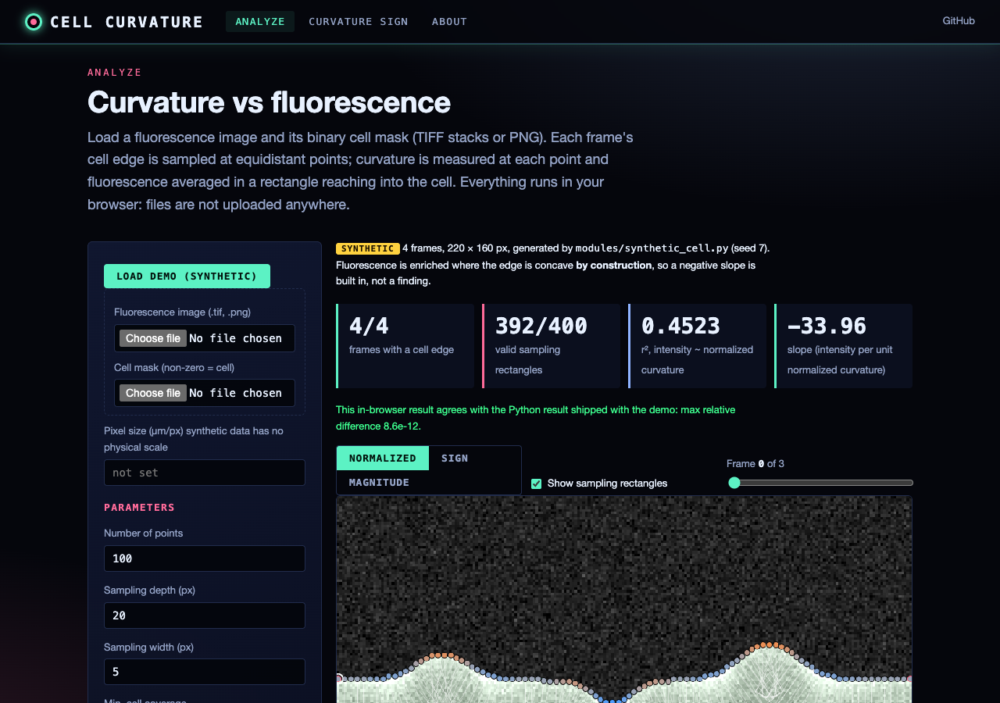

# Cell Curvature Analyzer

A comprehensive GUI application for analyzing the relationship between cell-membrane curvature and PIEZO1 protein locations from fluorescence microscope recordings.

## Features

- **Interactive Visualization**: View original images, binary masks, and analysis overlays side-by-side
- **Curvature Analysis**: Calculate three types of curvature (sign, magnitude, and normalized)
- **Intensity Correlation**: Analyze the relationship between curvature and fluorescence intensity
- **Temporal Analysis**: Track changes across frames and correlate with previous frames
- **Edge Movement Detection**: Classify cell edge regions as extending, retracting, or stable
- **Multi-tab Interface**: Dedicated views for different analysis aspects
- **Data Export**: Comprehensive export options for images, data, and reports

## Installation

### Prerequisites

- Python 3.7 or higher
- NumPy, Matplotlib, SciPy
- scikit-image
- pandas
- PyQt5
- tifffile

### Install from Source

```bash
# Clone the repository
git clone https://github.com/gddickinson/cell_curvature_analyzer.git
cd cell_curvature_analyzer

# Create and activate a virtual environment (optional but recommended)
python -m venv venv
source venv/bin/activate  # On Windows: venv\Scripts\activate

# Install the package
pip install -e .
```

## Usage

### Starting the Application

```bash
# If installed from source with -e flag
cell-curvature-analyzer

# Or run directly from the source directory
python main.py
```

### Loading Data

1. Click **Open Images** to load a microscope image stack (TIFF format)
2. Click **Open Masks** to load corresponding binary masks (TIFF format)
3. Set analysis parameters in the right panel
4. Click **Run Analysis** to process all frames

### Navigating the Interface

- **Visualization Tab**: View images and overlay analysis results
- **Analysis Results Tab**: View frame-specific measurements and correlation plots
- **Correlation Analysis Tab**: Explore relationships between curvature and intensity
- **Temporal Analysis Tab**: Analyze changes over time
- **Edge Movement Tab**: Study cell edge dynamics
- **Export Results Tab**: Export data and visualizations
- **Settings Tab**: Configure analysis and visualization parameters
- **Log Tab**: View logging information and debug messages

### Exploring Results

- Use the frame navigation controls to move between frames
- Toggle different overlay components in the visualization tab
- View curvature and intensity profiles in the analysis tab
- Explore correlations by movement type in the correlation tab
- Compare current frame with previous/random frames in the temporal tab

### Exporting Data

1. Go to the **Export Results** tab
2. Select the types of data to export (images, raw data, statistics, figures, report)
3. Choose an export directory
4. Click **Export Data**

## Analysis Methodology

### Curvature Measurement

The application calculates three types of curvature at points spaced equally along the cell edge:

1. **Sign Curvature (-1, 0 or 1)**: +1 where the edge bulges out of the cell (convex), -1 where it bends into the
   cell (concave), 0 where it is straight (|curvature| below the straight threshold)
2. **Magnitude Curvature (≥0)**: |curvature| in 1/px (1/radius) with smoothing; dimensionless with the legacy rule
3. **Normalized Curvature (-1 to 1)**: sign × magnitude / the frame's largest magnitude

Curvature options (parameter panel, web Analyze page; defaults in `modules/analysis_defaults.py`, code and full
description in `modules/edge_curvature.py`):

- **Curvature smoothing** (σ in px, default 6): the edge is smoothed with a Gaussian along its length and the curvature
  of the smoothed edge is used. **0 = none (legacy)**: the three-point rule used before 2026-11. Without smoothing the
  pixel staircase of the mask dominates single-point signs (on a 40 px circle at the default 100 points, only ~45 % of
  points come out convex). The default was chosen with `python scripts/curvature_benchmark.py` (seeded masks of known
  curvature, with segmentation noise).
- **Straight below** (1/px): points with |curvature| below this are straight (sign 0). With smoothing 0 and threshold 0
  straight runs count as -1, as before.
- **Point spacing**: equal arc-length steps (default) or **legacy**, the old sampler, whose steps were up to one
  contour segment short and left one large gap at the end of the edge.
- **Open edges** (a cell running off the image) are treated as open: the first and last points are not neighbours,
  and they are not sampled for intensity.

To reproduce results from before 2026-11: point spacing *legacy*, smoothing *none*, straight threshold 0 (identical for
cells inside the image; for border-touching edges the two end points now have no curvature and no intensity).

### Intensity Sampling

For each point along the cell edge:
1. An inward normal vector is calculated
2. A rectangular sampling region extends into the cell
3. The mean fluorescence intensity within this region is measured

### Edge Movement Analysis

The application classifies cell edge movement into three categories:
- **Extending**: Cell growth/protrusion (blue in visualizations)
- **Retracting**: Cell shrinkage/retraction (red in visualizations)
- **Stable**: Minimal net movement (gray in visualizations)

## Web interface and static site

A browser front end for the core analysis: load a fluorescence image and its binary cell mask (TIFF stacks, including
LZW/Deflate/PackBits and ImageJ files, or PNG), or the synthetic demo, set the parameters and get the edge overlay
coloured by curvature, the sampling rectangles, curvature and intensity profiles along the edge, the intensity vs
curvature regression pooled over frames, edge movement between frames, and CSV/JSON export. Pixel size (µm/px) is read
from ImageJ TIFFs or entered by hand; without it lengths stay in pixels and the page says so.



**Curvature sign convention** (documented in `modules/edge_curvature.py`, shown on the *Curvature sign* page and pinned by
tests on a circular mask): **+1 where the edge bulges out of the cell (convex)**, **-1 where it bends into the cell
(concave)**, **0 where it is straight**. It holds because `find_contours` always walks the edge with the cell on its right.


### Run the web app
```bash
pip install -r requirements-web.txt
python run_web.py            # http://127.0.0.1:8208 (local only)
```
The local app runs the Python core: `POST /api/analyze` passes the stack to `modules/web/analysis.py::analyze_stack`,
which uses `modules/edge_analysis.py` and `modules/edge_curvature.py` (the same functions `CurvatureAnalyzer` delegates
to). On the static site the JS port (`edge_engine.js`, `curvature_engine.js`) runs in the browser; a node test checks it
against Python.

### Static site (GitHub Pages)
`python scripts/build_static.py` writes `site/`; `.github/workflows/pages.yml` publishes it on every push to `main`.
On the static site the analysis runs in the browser: `modules/web/static/edge_engine.js` and `contour_engine.js` port the
Python core (including `skimage.measure.find_contours`, `skimage.draw.polygon` and `scipy.stats.linregress`), and nothing
is uploaded. `node modules/web/static/edge_engine.test.mjs` checks the port against Python results stored in
`tests/fixtures/edge_fixture.json` (regenerate with `python scripts/make_edge_fixture.py`); agreement is about 1e-14.

The demo data is synthetic (`modules/synthetic_cell.py`, seeded): fluorescence is enriched where the edge is concave by
construction, so the negative slope it shows is built in. The repository contains no measured recordings. Angular,
axis-based and x-axis sampling, temporal comparisons and report export remain desktop-only.

### Tests
```bash
python -m pytest -q tests                      # desktop core + web API + static build + JS port vs Python
python scripts/screenshots.py --static "" analyze/demo convention about   # smoke test (Playwright)
```

## Contributing

Contributions are welcome! Please feel free to submit a Pull Request.

1. Fork the repository
2. Create your feature branch (`git checkout -b feature/amazing-feature`)
3. Commit your changes (`git commit -m 'Add some amazing feature'`)
4. Push to the branch (`git push origin feature/amazing-feature`)
5. Open a Pull Request

## License

This project is licensed under the MIT License - see the LICENSE file for details.

## Acknowledgments

- This tool builds upon the curvature analysis approach described in [reference to relevant papers]
- Thanks to all contributors and the scientific community for feedback and suggestions


---
*Built with AI assistance from [Claude (Anthropic)](https://claude.com/).*
